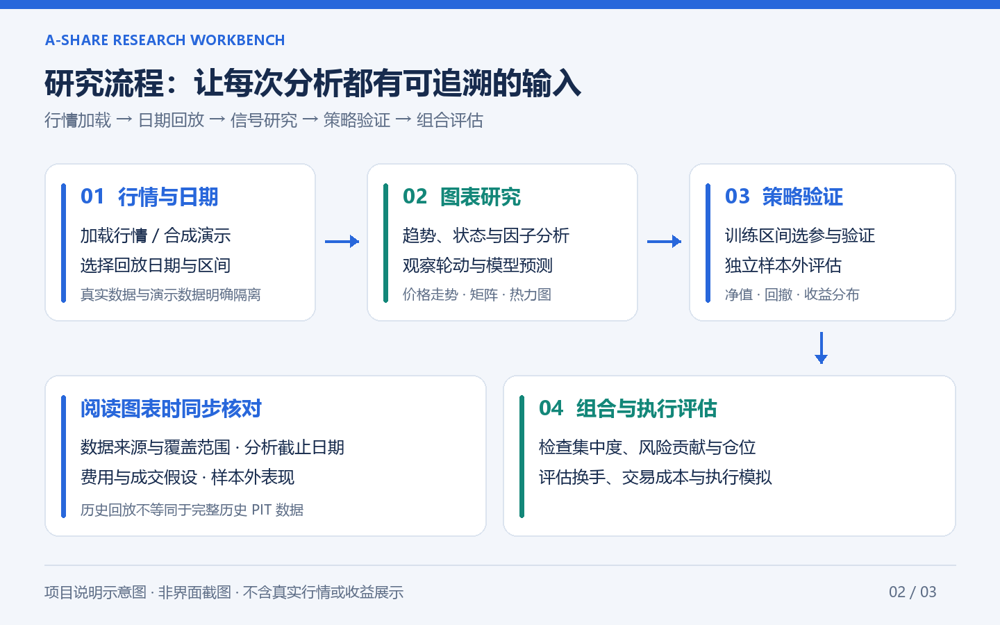
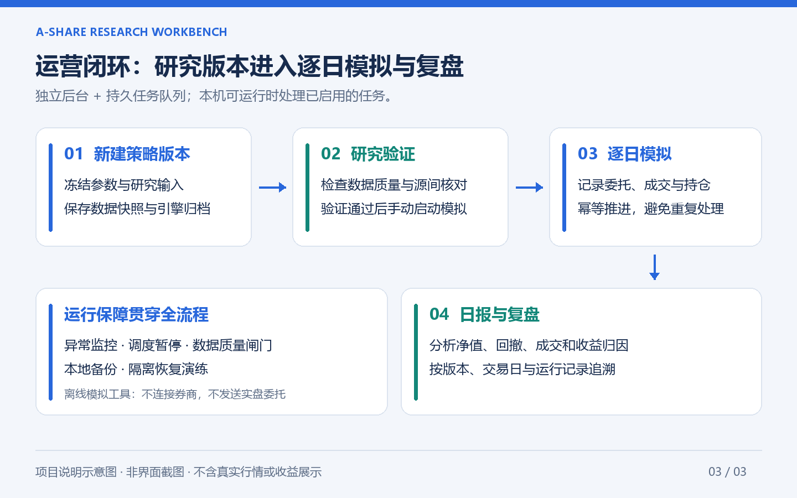

# A股研究工作台

**A-Share Research Workbench**

面向 A 股的本地量化研究与持续模拟平台，以图表为主要展示方式，连接行情分析、股票筛选、策略验证、模拟运行和交易复盘。

> 当前定位为本地研究与离线模拟工具，不连接券商、不发送实盘委托。数据源、回测与成交模型有明确限制，结果不构成投资建议，也不保证未来收益。

## 项目图解

以下为项目功能与流程示意图，帮助快速了解系统结构；**不是实际界面截图，也不展示真实行情或收益结果**。

### 功能全景


### 研究与历史回放流程



### 持续模拟与复盘闭环



## 功能模块

| 分类 | 模块 |
| --- | --- |
| 市场与标的 | 市场全景、行业与板块轮动、股票筛选与自选池、财务与估值、事件与公告日历 |
| 策略研究 | 趋势与反转、市场状态识别、多因子选股、机器学习选股、策略实验室 |
| 组合与执行 | 组合配置与风控、交易执行模拟、模拟持仓与交易复盘 |
| 运营与诊断 | 研究任务与持续模拟、文本分析、数据质量与来源 |

- **可视化研究**：价格与状态回放、转移矩阵、因子热力图、轮动轨迹、预测散点、净值与回撤、风险贡献、数据覆盖日历。
- **策略验证**：均线、动量和马尔可夫过滤；机器学习时间切分验证；训练区间选参与独立样本外评估。
- **持续模拟**：独立后台进程、持久任务队列、不可变策略版本、逐日委托与收益归因。
- **可追溯运行**：质量闸门、多源收盘核对、冻结数据快照、引擎归档、幂等推进、监控和隔离恢复演练。

## 快速开始

需要 Python 3.10 或以上版本。日常界面不需要 Node.js，Node.js 仅用于可选的界面逻辑测试。

```bash
git clone https://github.com/duoduohappy/ashare-research-workbench.git
cd ashare-research-workbench
python -m pip install -r requirements.txt
python server.py
```

浏览器打开 [http://127.0.0.1:8876](http://127.0.0.1:8876)。Windows 也可双击 `start.bat`，首次缺少依赖时会自动安装。

- **行情研究**：输入沪深股票代码，加载行情，或手动选择合成演示数据。
- **历史回放**：选择日期和区间，逐交易日查看状态与指标。
- **运营闭环**：进入「研究任务与持续模拟」，按「新建版本 → 研究验证 → 启动模拟 → 日报复盘」操作。

真实行情与合成演示明确隔离。新建策略默认是草稿，验证通过不代表自动启用或策略盈利。

## 后台与运行数据

`server.py` 会启动独立的本地 `ops_worker.py` 进程。关闭浏览器或 HTTP 服务后，后台仍可能处理已经启用的任务；电脑关机、睡眠或断网时不能运行。当前未配置开机自启，也不是云端托管。

在运营控制台可暂停调度、暂停单一策略或结束后台进程。再次启动后台不会自动开启已经暂停的调度。

程序运行后会生成本地数据库、行情缓存、快照、日志及备份；这些文件由 `.gitignore` 排除，不会随源码提交到 GitHub。升级前请创建备份，不要用源码包覆盖运行数据。

## 验证

```bash
python -m unittest -v
```

启动服务器后，可选运行：

```bash
node test_ui.cjs
```

隔离端到端验收：

```bash
python acceptance_ops.py
```

验收脚本使用独立目录、端口和合成账户，不修改用户运营数据库。它会启动本地辅助进程，结束时关闭这些验收进程；生成的本机验收记录与运行目录不提交到仓库。

测试范围、现有证据及尚未完成的验收见 [验证说明](docs/VALIDATION.md)。详细配置、计算口径和恢复步骤见 [使用说明](docs/USER_GUIDE.md)。

## 主要限制

- 公共行情、财务及公告接口可能延迟、修订、限流或失效，无可用性保证；对外使用须自行核对数据授权。
- 冻结当前可得数据可以支持复现，但不能还原未经修订的历史 PIT 数据。
- 行业轮动采用固定行业 ETF 代理；部分市场备用源不能核验行情所属日期，界面会提示覆盖范围与时间限制。
- 回测和执行模拟不能完整复原盘口、排队、冲击、特殊证券规则及公司行动；未覆盖情况可能阻断运营任务。
- 本地功能与隔离故障路径测试通过，不等于多周真实运行、真实浏览器视觉或实盘上线验收完成。
- 当前只绑定本机回环地址，未提供公网部署、多用户身份权限或实盘交易能力。

## 方法参考

市场状态分析思路参考 [Markov Hedge Fund Method](https://github.com/jackson-video-resources/markov-hedge-fund-method)。本项目将相关思路扩展为本地 A 股研究与模拟工作台，方法与数据的适用范围见详细说明。
