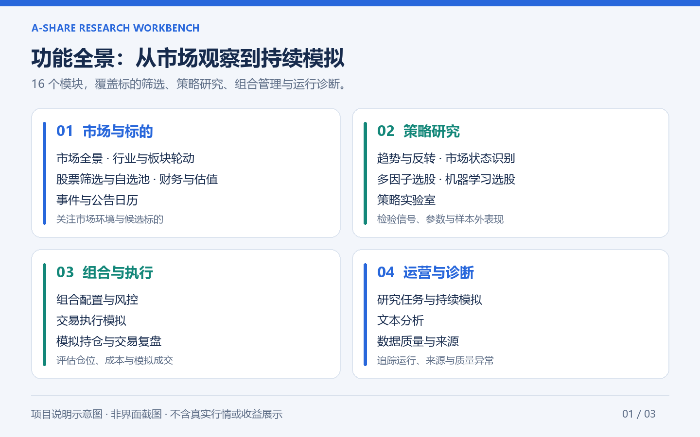

# A股研究工作台

**A-Share Research Workbench**

面向 A 股的本地量化研究与持续模拟平台，以图表为主要展示方式，连接行情分析、股票筛选、策略验证、模拟运行和交易复盘。

> 当前定位为本地研究与离线模拟工具，不连接券商、不发送实盘委托。数据源、回测与成交模型有明确限制，结果不构成投资建议，也不保证未来收益。

## 项目图解

以下为项目功能与流程示意图，帮助快速了解系统结构；**不是实际界面截图，也不展示真实行情或收益结果**。

### 功能全景



### 研究与历史回放流程


### 持续模拟与复盘闭环


## 功能模块

| 分类 | 模块 |
| --- | --- |
| 市场与标的 | 市场全景、行业与板块轮动、股票筛选与自选池、财务与估值、事件与公告日历 |
| 策略研究 | 趋势与反转、市场状态识别、多因子选股、机器学习选股、策略实验室 |
| 组合与执行 | 组合配置与风控、交易执行模拟、模拟持仓与交易复盘 |
| 运营与诊断 | 研究任务与持续模拟、文本分析、数据质量与来源 |

- **可视化研究**：价格与状态回放、转移矩阵、因子热力图、轮动轨迹、预测散点、净值与回撤、风险贡献、数据覆盖日历。
- **策略验证**：均线、动量和马尔可夫过滤；机器学习时间切分验证；训练区间选参与独立样本外评估。
- **因子验证**：20 日动量、5 日反转、20 日低波的 IC / Rank IC、三组远期收益、1/5/20 日衰减；训练期选择因子与方向，滚动样本外检验，导出逐日证据与区间边界。
- **组合算法实验**：Ledoit–Wolf / 样本协方差、风险平价约束近似、受约束最小方差；与等权、波动倒数统一比较样本外净值、回撤、换手和成本，披露训练边界与求解残差。
- **状态算法对照**：对角高斯 HMM、KMeans 与固定训练窗阈值马尔可夫；逐日因果过滤、滚动样本外 Brier / MAE、概率可靠性、训练特征与收敛诊断，导出参数可复核预测。
- **策略稳健性验收**：滚动训练选参、独立 63 日测试账户、训练参数稳定性、六组成本压力、额外一日信号延迟、配对移动区块重采样；逐折披露失败表现与不确定性。
- **持续模拟**：独立后台进程、持久任务队列、不可变策略版本、逐日委托与收益归因。
- **可追溯运行**：质量闸门、多源收盘核对、冻结数据快照、引擎归档、幂等推进、监控和隔离恢复演练。

## 已实现算法与验证

| 研究方向 | 当前实现 | 验证与图表 | 使用边界 |
| --- | --- | --- | --- |
| 市场状态 | 可观测马尔可夫链、对角高斯 HMM、KMeans | 逐日过滤、状态时间轴、转移矩阵、样本外 Brier / MAE、概率可靠性 | 单标的特征状态；隐状态概率与涨跌概率分别解释 |
| 因子研究 | 价值、质量、成长、红利、动量、低波评分；历史验证支持动量、反转、低波 | IC / Rank IC、ICIR、三组收益、1/5/20 日衰减、训练选因子的滚动检验 | 当前财报评分不回填历史；小股票池存在幸存者偏差 |
| 机器学习 | 岭回归、随机森林、直方图梯度提升 | 三段滚动验证、跨界标签隔离、逐折误差与基线、横截面 Rank IC | 预测未来五个观测日收益；不是费用后策略净值 |
| 组合配置 | 等权、波动倒数、风险平价约束近似、受约束最小方差 | Ledoit–Wolf / 样本协方差、七张对照图、求解残差、调仓预算核对 | 连续权重研究近似；未完整模拟 A 股成交规则 |
| 趋势与策略 | 均线、动量、马尔可夫过滤；突破与均值偏离观察 | 三策略对照、滚动训练选参、成本/信号延迟压力、配对区块重采样 | 独立测试窗不拼接账户；重采样不纠正多重检验；执行规则存在近似 |
| 执行模拟 | TWAP、前日成交量排程 VWAP、POV、冰山拆单 | 累计成交、容量限制、成本及未完成数量 | 离线分钟近似，不发送委托，不复原盘口排队 |
| 文本分析 | 本地词典、简单否定识别、原文摘句、数字提取；可选 Ollama 摘要 | 情绪分布、词频、原文与来源时间 | 默认方法为词典规则；摘要与情绪需核实 |

新增滚动研究实验披露训练截止日、测试区间和计算限制，不自动启用运营策略，也不根据同一批历史结果自动选出“最佳算法”。

| 详细文档 | 内容 |
| --- | --- |
| [因子验证](docs/FACTOR_VALIDATION.md) | 因子公式、分组、标签隔离、样本外抽样与证据限制 |
| [组合优化](docs/PORTFOLIO_OPTIMIZATION.md) | 风险贡献、约束求解、开盘研究近似、成本与资金核对 |
| [状态研究](docs/REGIME_RESEARCH.md) | HMM / 聚类训练、因果过滤、概率映射、参数导出与复核 |
| [策略稳健性](docs/STRATEGY_VALIDATION.md) | 独立测试窗、训练参数稳定性、成本/延迟压力和重采样区间 |
| [使用说明](docs/USER_GUIDE.md) | 数据来源、模块操作、计算口径和恢复步骤 |
| [验证说明](docs/VALIDATION.md) | 已完成的检查、复现命令和尚未完成的验收 |

## 快速开始

需要 Python 3.10 或以上版本。日常界面不需要 Node.js，Node.js 仅用于可选的界面逻辑测试。

```bash
git clone https://github.com/duoduohappy/ashare-research-workbench.git
cd ashare-research-workbench
python -m pip install -r requirements.txt
python server.py
```

浏览器打开 [http://127.0.0.1:8876](http://127.0.0.1:8876)。Windows 也可双击 `start.bat`，首次缺少依赖时会自动安装。

- **行情研究**：输入沪深股票代码，加载行情，或手动选择合成演示数据。
- **历史回放**：选择日期和区间，逐交易日查看状态与指标。
- **运营闭环**：进入「研究任务与持续模拟」，按「新建版本 → 研究验证 → 启动模拟 → 日报复盘」操作。

真实行情与合成演示明确隔离。新建策略默认是草稿，验证通过不代表自动启用或策略盈利。

进入「多因子选股」，候选池输入 5–8 只股票，点击「验证因子与滚动样本外表现」，可查看五张诊断图；至少需要 240 个共同交易日。这里的分组收益是描述性远期收益，不是可执行策略净值。进入「机器学习选股」可查看逐折误差、均值基线与标签隔离区间。详见[因子验证说明](docs/FACTOR_VALIDATION.md)。

进入「组合配置与风控」的「组合算法实验」，输入 2–8 只股票，可查看四种算法的七张对照图。以先前收盘估计权重、后续开盘做连续股数研究，统一扣除成本情景；包含首次建仓成本，不模拟 A 股实际成交规则。详见[组合优化说明](docs/PORTFOLIO_OPTIMIZATION.md)。

进入「市场状态识别」的「状态算法对照」，可查看 HMM、KMeans 与阈值马尔可夫的七张诊断图。默认至少 189 根日线；HMM 测试期仅使用逐日前向过滤，状态概率与上涨事件概率分别展示。详见[状态研究说明](docs/REGIME_RESEARCH.md)。

进入「策略实验室」的「策略稳健性验收」，沿用上方候选周期和资金设置，运行滚动选参与七张诊断图。默认至少 525 根日线；只统计完整的独立测试窗，不合成为连续账户净值。详见[策略稳健性说明](docs/STRATEGY_VALIDATION.md)。

## 后台与运行数据

`server.py` 会启动独立的本地 `ops_worker.py` 进程。关闭浏览器或 HTTP 服务后，后台仍可能处理已经启用的任务；电脑关机、睡眠或断网时不能运行。当前未配置开机自启，也不是云端托管。

在运营控制台可暂停调度、暂停单一策略或结束后台进程。再次启动后台不会自动开启已经暂停的调度。

程序运行后会生成本地数据库、行情缓存、快照、日志及备份；这些文件由 `.gitignore` 排除，不会随源码提交到 GitHub。升级前请创建备份，不要用源码包覆盖运行数据。

升级已有安装时，重新安装依赖并重启 Python 服务，再刷新浏览器，以加载新增算法和接口。

若页面提示后台版本不匹配，请在原服务终端按 `Ctrl+C` 停止旧服务，再运行 `python server.py` 或重新打开 `start.bat`。只刷新页面会更新前端文件，不会重载正在运行的 Python 接口。

浏览器脚本已打包到既有的 `advanced.js` 入口，避免旧后台静态路由缺少新脚本时出现 `syncStrategyValidation is not defined` 等初始化错误。后台兼容性提示会保留到服务升级完成。

## 验证

当前本机验证记录：**82 项单元测试通过，隔离 HTTP 接口与无浏览器界面逻辑测试通过**。这些结果验证实现与受控路径，不等于投资有效性、真实浏览器视觉或多周真实行情运行验收。

```bash
python -m unittest -v
```

启动服务器后，可选运行：

```bash
node test_ui.cjs
node test_browser_bootstrap.cjs
node test_browser_bootstrap.cjs --legacy-fixture
```

隔离端到端验收：

```bash
python acceptance_ops.py
```

验收脚本使用独立目录、端口和合成账户，不修改用户运营数据库。它会启动本地辅助进程，结束时关闭这些验收进程；生成的本机验收记录与运行目录不提交到仓库。

测试范围、现有证据及尚未完成的验收见 [验证说明](docs/VALIDATION.md)。详细配置、计算口径和恢复步骤见 [使用说明](docs/USER_GUIDE.md)。

## 前端开发

日常使用无需构建；仓库包含可直接运行的脚本包。修改 `ui/advanced_core.js` 或因子、组合、状态、策略验收脚本后，执行：

```bash
python build_ui.py
python build_ui.py --check
```

`advanced.js` 为生成文件，应修改对应源码并重新构建。新增界面模块应加入 `build_ui.py` 的来源清单；页面继续使用既有脚本入口。界面逻辑测试从 HTTP 页面读取并加载真实脚本引用，另以旧版静态路由模拟验证升级兼容性，不等同真实浏览器视觉验收。

## 主要限制

- 公共行情、财务及公告接口可能延迟、修订、限流或失效，无可用性保证；对外使用须自行核对数据授权。
- 冻结当前可得数据可以支持复现，但不能还原未经修订的历史 PIT 数据。
- 行业轮动采用固定行业 ETF 代理；部分市场备用源不能核验行情所属日期，界面会提示覆盖范围与时间限制。
- 回测和执行模拟不能完整复原盘口、排队、冲击、特殊证券规则及公司行动；未覆盖情况可能阻断运营任务。
- 本地功能与隔离故障路径测试通过，不等于多周真实运行、真实浏览器视觉或实盘上线验收完成。
- 当前只绑定本机回环地址，未提供公网部署、多用户身份权限或实盘交易能力。

## 方法参考

市场状态分析思路参考 [Markov Hedge Fund Method](https://github.com/jackson-video-resources/markov-hedge-fund-method)。本项目将相关思路扩展为本地 A 股研究与模拟工作台，方法与数据的适用范围见详细说明。
